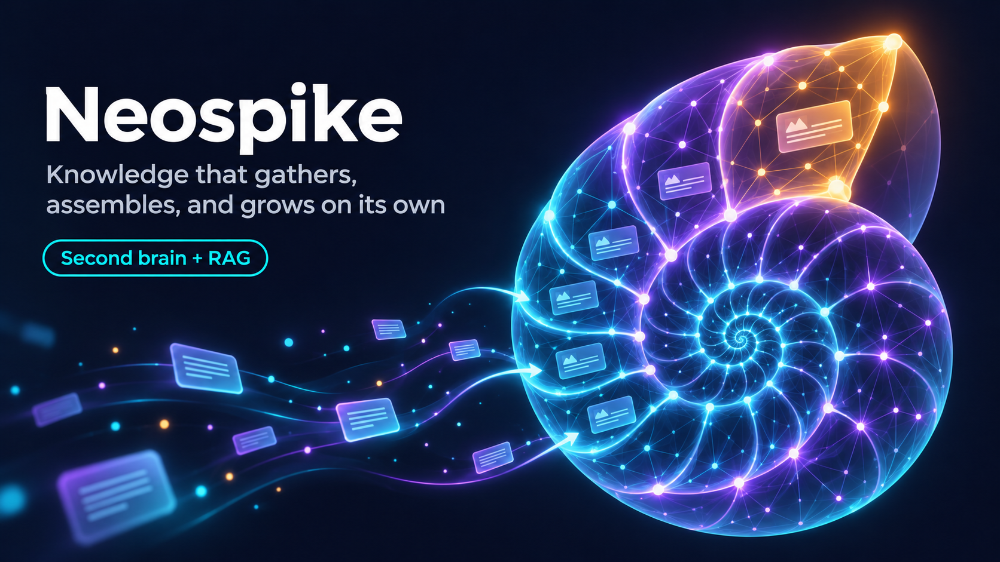

# Neospike



**An AI agent whose knowledge gathers, assembles, and grows on its own. Second brain + RAG, for [Hermes Agent](https://github.com/NousResearch/hermes-agent).**

Neospike is a memory provider plugin for Hermes Agent. The agent saves short facts and decisions as it works, keeps long documents as notes, and indexes past conversations. Code then tidies that knowledge in the background without calling an LLM: related memories are linked, linked groups become topics, and a topic that grows large becomes a note. One daily stage is the exception: it asks your Hermes model whether similar preferences should be kept, merged or removed (it can be turned off). Embeddings are computed on your machine and everything is stored in one SQLite file.

> Status: used daily on Windows 10. Linux and macOS have not been verified on real machines.

## What you get

| Part | What it holds |
|---|---|
| **Memory** | One short fact, decision, preference or constraint per item (up to 2,000 characters), saved by the agent. |
| **Notes** | Long documents the agent writes: designs, reports and `TASK_NNN` work orders. |
| **Docs** | Notes you wrote yourself. The agent and background jobs can read them but not change them. |
| **Preferences** | Your standing preferences and constraints, kept apart from memories. |
| **Conversations** | Past Hermes chats, copied in and indexed for search. |
| **Topics** | Groups of related memories, made and named by code. |

On top of that storage:

- **Automatic recall.** Before each turn, up to 8 matching memories and note sections (cosine 0.7 or more) are added to the agent's context. Items the conversation already contains are skipped.
- **Preferences in context.** Preferences without a situation are shown once per conversation. Preferences tied to a situation are shown when the current message matches that situation, at most 3 per turn. A constraint always needs a situation, so it is never shown in every conversation.
- **Dashboard tab** in the Hermes web dashboard: Map (a 3D view of memories, notes and topics, with folders), Notes, Docs, Memory, Preferences, Conversations, Config and Setup. The interface is English or Korean, following the dashboard language.
- **MCP server** for Claude Code and other MCP clients: `mem_search`, `note_read`, `note_related`, `note_append_report`.
- **Markdown export** of notes as a zip. Export is one-way; the database stays the source of truth.
- **Backups.** The daily job writes a full snapshot first and incremental backups after that.

## How knowledge grows

1. **Saving.** The agent saves one fact per memory. Text over 2,000 characters, or with two or more headings, is stored as a note instead.
2. **At save time.** The new memory is compared with its 3 nearest neighbours. An older memory that says the same thing (cosine 0.90 or more, word counts within 2) is removed. Older items with cosine 0.80 or more are returned to the agent, which corrects or deletes them in one `neospike_memory_reconcile` call so that the newest content wins.
3. **Linking.** Each memory is linked to up to 3 others with cosine 0.6 or more. A memory with cosine 0.8 or more to a section of an automatic note joins that note.
4. **Topics.** A linked group of more than 5 memories without a topic becomes a topic. A topic with more than 10 memories becomes an automatic note with one section per memory, and those memories and the topic are removed.
5. **Your edits win.** A correction applies at once and the old text is kept as history. Automated jobs never change a note you wrote.

Steps 3 and 4 are plain code. They run after a save and in the daily job; no LLM is called. Preferences and constraints that are similar but not exact duplicates are judged once a day by an LLM (see [Daily job](#daily-job)).

## Requirements

- [Hermes Agent](https://github.com/NousResearch/hermes-agent). The web dashboard is needed only for the Neospike tab.
- Python 3.11 or newer, and [uv](https://docs.astral.sh/uv/) on the `PATH` (the installer uses it because Hermes environments may not include pip).
- About 600 MB of disk space for the embedding model.

The embedding model is BAAI/bge-m3 as an int8 ONNX file from `Xenova/bge-m3`, pinned to one revision. It produces 1,024-dimension vectors and reads up to 2,048 tokens per input. It is MIT-licensed and not gated, so no Hugging Face account is needed. The plugin does not ship the model; the installer downloads it.

## Install

```bash
git clone https://github.com/Daniel-Heo/hermes-neospike.git
cd hermes-neospike
python install.py          # python3 on Linux/macOS
```

Then restart the gateway and check the result:

```bash
hermes gateway restart
python install.py --check
```

Opening a new Desktop window is not enough: the running gateway keeps the old code loaded.

`install.py` does the following, in this order:

1. installs the package into the Python that Hermes uses for its CLI;
2. copies the plugin to `$HERMES_HOME/plugins/neospike` (an existing copy is kept as `neospike.previous`) and adds it to `plugins.enabled`;
3. creates `MEMORY_RULE.md` for each Hermes home that uses Neospike, unless the file already exists;
4. enables the plugin so that the Hermes package manager installs `numpy` and `faiss-cpu` into the Hermes runtime;
5. downloads the model;
6. sets `memory.provider` to `neospike`;
7. registers the daily cron job `neospike-daily` (every day at 4am);
8. registers the `neospike` MCP server in Claude Code at user scope.

| Option | Effect |
|---|---|
| `--home <path>` | Install into this Hermes home instead of the default one. |
| `--skip-models` | Do not download the model. |
| `--check` | Verify an existing installation and change nothing. |
| `--dry-run` | Print the planned copies and commands and change nothing. |

`$HERMES_HOME` is `%LOCALAPPDATA%\hermes` on Windows and `~/.hermes` on Linux and macOS. Data lives in `$HERMES_HOME/neospike`.

### Hermes profiles

Each profile keeps its own database. All profiles share the embedding service and the model of the root Hermes home, and the root home's daily job covers every profile. Installing into a profile (`--home <root>/profiles/<name>`) therefore registers no cron job and leaves the MCP entry pointing at the root home.

## Tools

The agent gets these tools from the provider:

| Tool | Purpose |
|---|---|
| `neospike_memory_save` | Save one memory, preference or constraint. |
| `neospike_memory_update` | Correct an item in place, or supersede it when a decision changed. |
| `neospike_memory_delete` | Remove one item. |
| `neospike_memory_reconcile` | Settle the older, similar items returned by a save. |
| `neospike_memory_search` | Search stored knowledge. |
| `neospike_note_read` | Read a whole note (agent or automatic). |
| `neospike_note_write` | Create or update a note. |
| `neospike_doc_read` | Read a whole doc (a note the user wrote). |
| `neospike_doc_write` | Edit an existing doc, only when the user asks. |

MCP clients get a smaller, mostly read-only set:

| Tool | Purpose |
|---|---|
| `mem_search` | Search memories, notes and docs at once. |
| `note_read` | Read one note or doc by id or exact title. |
| `note_related` | Backlinks, outgoing links and the most similar notes. |
| `note_append_report` | Append a work report to a `TASK_` note. |

## Configuration

Settings are in `$HERMES_HOME/neospike/config.json`.

| Key | Default | Meaning |
|---|---|---|
| `conversation_capture` | `true` | Copy user and assistant turns into the conversation store, with secrets masked. |
| `conversation_prefetch` | `false` | Also add conversation excerpts to automatic recall. |
| `recall_log_enabled` | `true` | Write one log line per recall under `neospike/logs` (ids and scores only, never the query text). |
| `recall_log_months` | `12` | Months of recall logs to keep. |
| `turn_trace_enabled` | `false` | Add short Neospike diagnostics to chat replies. |
| `map_recent_days` | `7` | Age below which the Map shows an item as recent. |
| `map_stale_days` | `14` | Age above which the Map shows an item as old. |
| `extraction_language` | `en` | Language (`en` or `ko`) Neospike uses when it extracts memories from conversations. Set it in the Config tab. |
| `pref_reconcile_enabled` | `true` | Run the daily `pref-reconcile` stage, the only stage that calls an LLM. |

The rules that tell the agent what to save are the text of `$HERMES_HOME/neospike/MEMORY_RULE.md`. Edit it in the Config tab or in any editor.

Environment variables:

| Variable | Meaning |
|---|---|
| `HERMES_HOME` | The Hermes home to use. |
| `HERMES_PYTHON` | The Hermes Python to use when the installer cannot find it. |
| `HERMES_BGE_M3_DIR` | Folder that holds the model files, if not the default `models/bge-m3-onnx`. |
| `NEOSPIKE_INFERENCE_HOME` | Home whose embedding service all profiles share, if not the root home. |

## Daily job

`neospike-daily` runs these stages in order. All of them are code only, except `pref-reconcile`.

1. `backup`: back up the database.
2. `link-prune`: remove links whose memory or note is gone.
3. `conv-import`: bring in conversations added or changed since the last run.
4. `conv-index`: index the new conversation text.
5. `embed-pending`: embed memories that were saved while the embedder was unavailable, then link them.
6. `pref-reconcile`: find preference or constraint pairs of the same user with cosine 0.8 or more that are not exact duplicates, and ask an LLM (32 pairs per call, at most 4 calls a day) to keep both, merge them, or delete one. A preference the user stated is never deleted because of one the agent inferred. Pairs judged "keep" are not asked again until one of them changes. A merged row is embedded the next day.
7. `topic-discover`: turn linked groups into topics.
8. `topic-to-note`: turn large topics into notes.

A failure is reported to Bot Chat. A successful run reports nothing.

## Command line

```bash
python -m neospike.cli --home <home> <command>
```

Use the Python that `install.py` installed the package into. `--help` lists every command. The main groups are:

- memories: `memory-search`, `memory-count`, `memory-update`, `memory-delete`, `memory-revisions`, `memory-restore`
- notes: `note-save`, `note-read`, `note-search`, `note-delete`, `note-restore`
- preferences: `pref-add`, `pref-update`, `pref-delete`, `pref-list`
- conversations: `conv-import`, `conv-index`, `conv-search`, `conv-read`
- backup and maintenance: `backup`, `backup-restore`, `reembed`

A database embedded with a different model or dimension is refused until `reembed` rewrites its vectors. Back up `neospike/memory.db` first.

## Privacy

- Embedding, search and every background job run on your machine. Only the daily `pref-reconcile` stage calls an LLM: it sends pairs of similar preferences (text, situation, basis, time) to the auxiliary model Hermes is configured with (`auxiliary.neospike_pref_reconcile` in the Hermes config, else the main model). Set `pref_reconcile_enabled` to `false` to stop it.
- Recalled text goes only to the model your agent already uses.
- Text that looks like a credential or a prompt-injection attempt is rejected when it is saved.
- Recalled text is given to the agent as data, not as instructions.

## Development

```bash
uv sync
uv run pytest
```

## License

Apache-2.0. See [LICENSE](LICENSE) and [NOTICE](NOTICE). The model keeps its own licence.

## References

- [Hermes Agent](https://github.com/NousResearch/hermes-agent): the `MemoryProvider` and dashboard plugin interfaces.
- [BAAI/bge-m3](https://huggingface.co/BAAI/bge-m3) and the ONNX conversion [Xenova/bge-m3](https://huggingface.co/Xenova/bge-m3).
